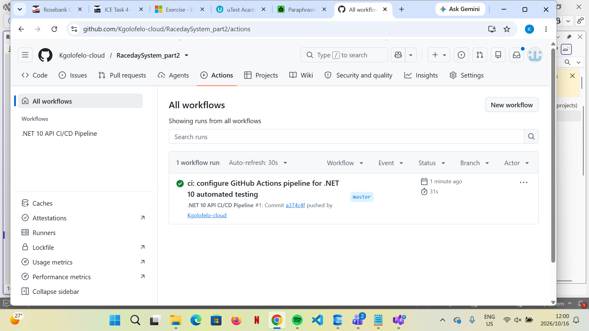

# RaceDay Backend API
 
## Project Overview
The RaceDay API is built with ASP.NET Core Web API (.NET 10) and Entity Framework Core (Code-First). It manages race events, categories, registrations, and final results.
 
## User Roles
* **Organiser:** Can create race events, define race categories (distances and entry fees), and capture final race results.
* **Participant:** Can view upcoming events, enrol in specific race categories, and track their personal race history and finish times.
 
## Setup Instructions
1. Clone this repository and open the solution in Visual Studio.
2. Open `appsettings.json` and ensure the `DefaultConnection` string points to your local SQL Server:
   `Server=(localdb)\\mssqllocaldb;Database=RaceDay_Database;Trusted_Connection=True;TrustServerCertificate=True;MultipleActiveResultSets=true`
3. Open the Package Manager Console and run `Update-Database` to generate the SQL schema.
4. Press `F5` to run the application. The Swagger UI will launch automatically to test the endpoints.
 
## CI/CD Pipeline Status
*(Screenshot of the successful GitHub Actions build will be below)*

 
## Video Presentation
[Link here]
